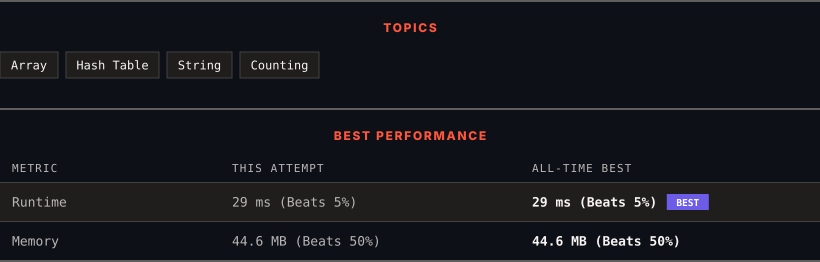

<div align="center">

# 819. Most Common Word

      

[](https://leetcode.com/problems/most-common-word/)

</div>

---

<div align="center">

<picture>
  <source media="(prefers-color-scheme: dark)" srcset="panel-dark.svg">
  <source media="(prefers-color-scheme: light)" srcset="panel-light.svg">
  
</picture>

</div>

> **New personal best** — Runtime improved on this submission.

### HOW IT WENT

| | |
|:--|:--|
| **Attempts** | first try |
| **Time to solve** | 1 min |
| **Verdicts** | ✅ Accepted |

---

### NOTES

_No notes yet._

---

### SOLUTIONS (1)

| # | File | Language | Date |
|:-:|------|:--------:|:----:|
| 1 | [sol1.java](./sol1.java) | `Java` | 2026-10-28 ← **latest** |

---

### PROBLEM DESCRIPTION

Given a string `paragraph` and a string array of the banned words `banned`, return *the most frequent word that is not banned*. It is **guaranteed** there is **at least one word** that is not banned, and that the answer is **unique**.

The words in `paragraph` are **case-insensitive** and the answer should be returned in **lowercase**.

**Note** that words can not contain punctuation symbols.

 

**Example 1:**

```

**Input:** paragraph = "Bob hit a ball, the hit BALL flew far after it was hit.", banned = ["hit"]
**Output:** "ball"
**Explanation:** 
"hit" occurs 3 times, but it is a banned word.
"ball" occurs twice (and no other word does), so it is the most frequent non-banned word in the paragraph. 
Note that words in the paragraph are not case sensitive,
that punctuation is ignored (even if adjacent to words, such as "ball,"), 
and that "hit" isn't the answer even though it occurs more because it is banned.

```

**Example 2:**

```

**Input:** paragraph = "a.", banned = []
**Output:** "a"

```

 

**Constraints:**

	- `1 <= paragraph.length <= 1000`

	- paragraph consists of English letters, space `' '`, or one of the symbols: `"!?',;."`.

	- `0 <= banned.length <= 100`

	- `1 <= banned[i].length <= 10`

	- `banned[i]` consists of only lowercase English letters.

---

<div align="center">

<sub>Auto-synced by <strong>LeetSync</strong> · Built by <a href="https://deveshsamant.in/">Devesh Samant</a></sub>

</div>
