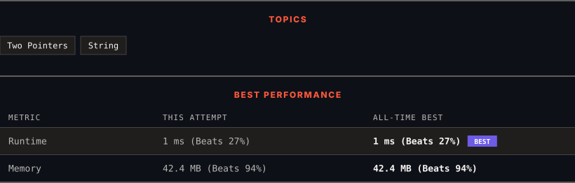

<div align="center">

# 917. Reverse Only Letters

      

[](https://leetcode.com/problems/reverse-only-letters/)

</div>

---

<div align="center">

<picture>
  <source media="(prefers-color-scheme: dark)" srcset="panel-dark.svg">
  <source media="(prefers-color-scheme: light)" srcset="panel-light.svg">
  
</picture>

</div>

> **New personal best** — Runtime improved on this submission.

### HOW IT WENT

| | |
|:--|:--|
| **Attempts** | first try |
| **Time to solve** | 1 min |
| **Verdicts** | ✅ Accepted |

---

### NOTES

_No notes yet._

---

### SOLUTIONS (1)

| # | File | Language | Date |
|:-:|------|:--------:|:----:|
| 1 | [sol1.java](./sol1.java) | `Java` | 2026-10-28 ← **latest** |

---

### PROBLEM DESCRIPTION

Given a string `s`, reverse the string according to the following rules:

	- All the characters that are not English letters remain in the same position.

	- All the English letters (lowercase or uppercase) should be reversed.

Return `s`* after reversing it*.

 

**Example 1:**

```
**Input:** s = "ab-cd"
**Output:** "dc-ba"

```

**Example 2:**

```
**Input:** s = "a-bC-dEf-ghIj"
**Output:** "j-Ih-gfE-dCba"

```

**Example 3:**

```
**Input:** s = "Test1ng-Leet=code-Q!"
**Output:** "Qedo1ct-eeLg=ntse-T!"

```

 

**Constraints:**

	- `1 <= s.length <= 100`

	- `s` consists of characters with ASCII values in the range `[33, 122]`.

	- `s` does not contain `'\"'` or `'\\'`.

---

<div align="center">

<sub>Auto-synced by <strong>LeetSync</strong> · Built by <a href="https://deveshsamant.in/">Devesh Samant</a></sub>

</div>
